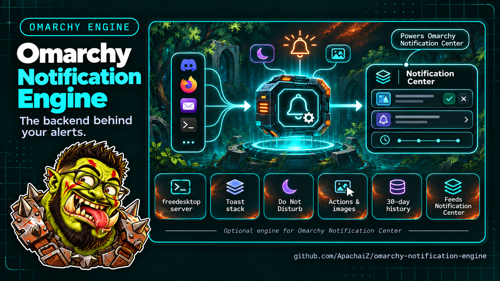

# Omarchy Notification Engine

The notification daemon behind the optional
[Notification Center](https://github.com/ApachaiZ/omarchy-notification-center).
It owns the freedesktop notification server, displays the toast stack, handles
Do Not Disturb, actions and images, and keeps an optional 30-day history.



While enabled it **replaces `omarchy.notifications`**: there is only one
notification server per session, and the shell's clone guard disables the stock
service. The center is a separate plugin and is **not required** for the engine
to work; conversely, the center works without the engine by reading
`omarchy.notifications` history.

## Install

```bash
omarchy plugin add https://github.com/ApachaiZ/omarchy-notification-engine --enable --yes
```

This installs and enables the engine. `omarchy.notifications` is disabled by
the clone guard; no manual step is needed after the command.

**Warning:** installing this engine replaces `omarchy.notifications` for
notification display and management. Only one server can own the notification
bus. To return to the stock service:

```bash
omarchy plugin remove apach.notification-engine
omarchy plugin enable omarchy.notifications
```

The center can be installed separately and works with either service.

## Capture and history

The engine reads the optional center's settings file
(`~/.local/state/omarchy/notifications-center.json`):

- **Capture history On** (default) — received notifications are displayed and
  kept in the 30-day history (up to 1000 entries).
- **Capture history Off** — live toasts still display and remain actionable,
  but nothing new is written to history. Existing history is untouched.

The same file carries two security switches, both on by default:

- **Actions** — run the click action (`omarchy-exec-argv`) when a toast is
  clicked. Turn it off to ignore every action hint.
- **DND bypass** — let Omarchy confirmation toasts and critical `notify-send`
  messages through Do Not Disturb. Turn it off to silence them too.

On first start the engine merges the pre-split archive from
`~/.local/state/omarchy/notifications-center/` and any old per-file history
under `~/.local/state/omarchy/notifications/history/` into its own archive.
Once the merged copy is saved, the old archive file and per-file history
directory are removed so a clear or an upgrade leaves no second copy of the
text on disk. Image copies referenced by surviving entries stay in the legacy
tree until their entry expires or the history is cleared; a clear removes the
whole tree, even if it runs during startup.

Without the center the engine captures by default and the **Show recent
notifications** keybinding replays the newest entries from the archive itself.
The archive lives in `~/.local/state/omarchy/notifications-archive.json`; live
toasts and their copied images live under
`~/.local/state/omarchy/notifications/`. The archive is `0600`; the engine's
private subdirectories are created with mode `0700`. The shared parent state
directory is owned by the shell and may be traversable, which is why the files
inside it never rely on directory permissions alone.

## Security and privacy

- Notifications are untrusted input. Remote image URLs and non-local URI
  schemes are dropped; `` tags are stripped from bodies before Qt parses
  them. App names, summaries and bodies are capped (256/512/8192 characters)
  at ingestion and when history is reloaded, so one sender cannot exhaust
  memory or bloat the state files. Image paths, app icons and the exec hint are
  capped too (2 KiB / 2 KiB / 16 KiB). Every `Text` element sets
  `Text.PlainText`, except the body, which is `Text.StyledText` only after the
  image tags have been stripped; `tests/qml-text.test.mjs` enforces this.
- The Omarchy `omarchy-exec-argv` action hint runs after the user clicks a toast
  (or explicitly invokes the most recent toast through the shell's
  `notifications invokeLast` IPC) and is an argv vector, never a shell string.
  It is capped (64 arguments, 4 KiB each, 16 KiB total) and refuses NUL bytes.
  Any session-bus process can set it and choose the app name, so a local app
  can impersonate Omarchy's own sender; treat notifications from untrusted apps
  as same-user code execution and turn **Actions** off when that matters.
- **DND bypass** trusts the sender-chosen app name as well (`omarchy-action`,
  critical `notify-send`). It is a convenience, not an authentication; turn it
  off to make Do Not Disturb absolute.
- The engine performs no network access and runs inside the existing
  `omarchy-shell` process.
- State files and image copies stay local; state directories are `0700` and
  the archive JSON is written atomically with mode `0600`, so other local users
  cannot read notification text even where the parent directory is
  traversable. Live popup JSON and copied images use the same private umask
  and modes, including on the first notification before startup initialization
  has finished. Images for expired or overflow entries are cleaned after live
  popups have been restored, so the startup merge cannot skip them. The JSON is
  passed on stdin, never in process arguments. A save that finds a different
  payload still queued is flagged for a corrective rewrite, so clearing history
  while a write is in flight cannot resurrect the cleared text after a
  restart. A failed archive write is retried with backoff instead of being
  silently dropped. At most eight toasts are shown at once; the oldest is
  archived when a ninth arrives.

## Remove

```bash
omarchy plugin remove apach.notification-engine
omarchy plugin enable omarchy.notifications
```

History is left untouched. Clearing history also removes the pre-split
`notifications-center/` archive, the old per-file history directory, and their
image copies, so a clear leaves no second copy on disk.

## Development

The pure notification helpers are tested with Node's built-in runner:

```bash
node --test tests/*.test.mjs
```

## License

GPL-3.0. See [LICENSE](LICENSE). The notification service is derived from
Omarchy's notification plugin and keeps the upstream attribution and license.
